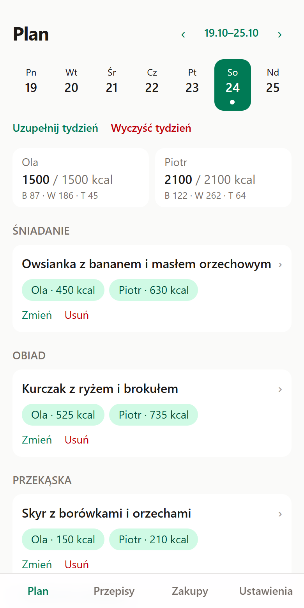
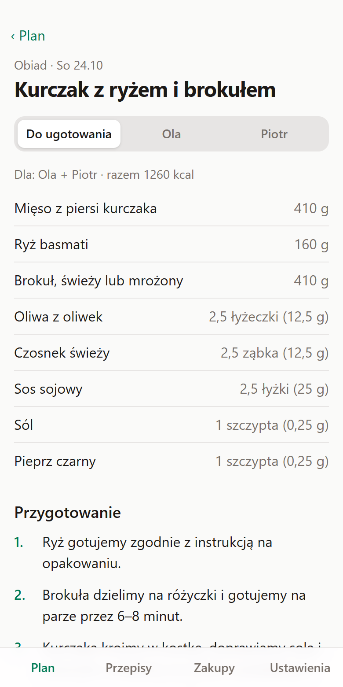
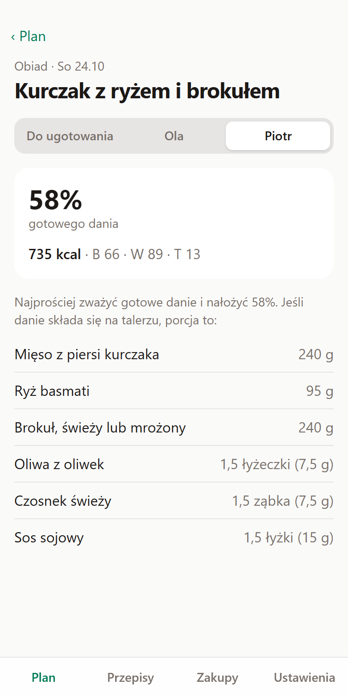
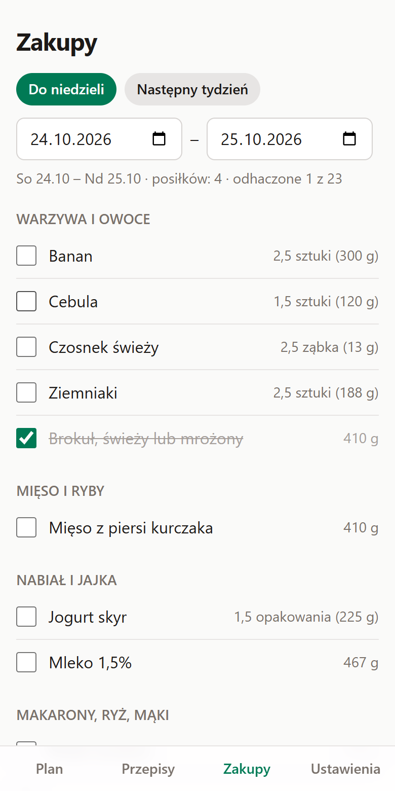

# Makromenu

[](https://github.com/pete29/makromenu/actions/workflows/deploy.yml)

A weekly meal planner for two people who eat the same meals but need different amounts. You plan one shared menu, and every recipe is scaled to each person's calorie target: one pot to cook, a different plate for each person. The plan turns into a shopping list.

The app is in Polish and runs on the phone as an installable PWA that works offline.

**Live demo:** https://pete29.github.io/makromenu/ (with made-up sample recipes)

<table>
  <tr>
    <td></td>
    <td></td>
    <td></td>
    <td></td>
  </tr>
  <tr>
    <td>Day plan: 1500 and 2100 kcal from the same meals</td>
    <td>One pot to cook for both</td>
    <td>Piotr's plate: 58% of the dish</td>
    <td>Shopping list by store section</td>
  </tr>
</table>

## Why

My partner and I follow meal plans from a dietitian with different calorie targets. The plans come as a PDF of recipes for one person, so every meal meant recalculating ingredients for two portions, cooking once and splitting the pot by eye. This app does that arithmetic and keeps the week, the shopping list and both phones in sync.

## Features

- **Weekly planner.** Pick a recipe for each meal or fill the week automatically: recipes matching the meal type, close to the calorie target, no repeats on neighbouring days.
- **One pot, two plates.** For every meal: what to cook for everyone together, and each person's plate as a share of the finished dish, kcal and macros, or ingredients for a plate assembled separately.
- **Calorie targets per person.** A daily target and a split across meals for each person. A large gap between people is handled with an extra snack for one of them instead of an extreme portion.
- **Shopping list.** Ingredients summed over any range of days, grouped by store section, with check-off shared between phones.
- **Shared plan, two accounts.** Log in with an e-mail code; invite the other person and both accounts edit one plan, live.
- **Offline first.** Everything works without a connection and syncs when it's back. Backup and restore through a file.
- **Recipe import from PDF.** The dietitian's PDF is turned into JSON with ingredients, steps, macros and photos.

## How scaling works

Recipes come with kcal and macros per serving. Calories are linear in ingredient weights, so a person's portion factor is their meal target divided by the recipe's kcal per serving. The pot is cooked for the sum of everyone's factors and split by share.

Common-sense rules keep portions practical:

- household units are rounded to halves (glasses to quarters) and never to zero, with Polish inflection (1 sztuka, 2 sztuki, 5 sztuk),
- grams are rounded to 1, 5 or 10 g depending on size,
- pinches of salt and pepper are not scaled,
- portions outside 0.6–1.6× of a serving are flagged,
- plates are rounded one by one and the last plate gets the remainder, so they add up to the pot.

Meal targets are relative to the person's full day (e.g. breakfast 30%, lunch 35%, snack 10%, dinner 25%), so they don't change while a day is being planned, and a complete day adds up exactly to the daily target.

## Architecture

```
src/engine/    scaling, planning, auto-fill, shopping list: plain TypeScript, unit-tested, no React
src/data/      Dexie database, cloud sync and sharing, import, backup, React hooks
src/screens/   React screens and components
scripts/       recipe PDF -> JSON (Node) and photos -> JSON (Python, PyMuPDF)
```

Some decisions behind it:

- **PWA instead of a native app.** Free, permanent on an iPhone (no 7-day signing), and a clickable demo. The engine has no browser dependencies, so it could move to React Native.
- **Dexie Cloud for sync.** The app was already offline-first on Dexie (IndexedDB); Dexie Cloud syncs that same database, so there is no sync code of my own. Primary keys are globally unique, and samples and default profiles are built in rather than stored, so a new device never pushes duplicates to the account.
- **Sharing through a realm.** The owner's data moves into a shared Dexie Cloud realm; a creating-hook puts everything added later into it. The invite is accepted in the app, because on iPhone an e-mailed link opens Safari, not the installed app (the same reason login uses a code, not a magic link).
- **Calories from the recipe, not from a nutrition database.** Scaling needs only kcal per serving, which the PDF provides, so the engine works without a per-ingredient database.

## Recipes and privacy

The recipes I use come from a dietitian and are not part of this repository or the public demo. The app ships with a few made-up sample recipes; real ones are imported in Settings from a JSON file:

```sh
pdftotext -enc UTF-8 -layout Przepisy.pdf przepisy.txt
node scripts/import-pdf.mjs przepisy.txt recipes.json
python scripts/attach-pdf-images.py Przepisy.pdf recipes.json   # adds the photos
```

## Stack

React 19, TypeScript, Vite, Tailwind CSS 4, Dexie (IndexedDB) with Dexie Cloud, vite-plugin-pwa.

Tests: Vitest unit tests for the engine, import and backup; Playwright end-to-end tests ([`e2e/`](e2e)) on a production build with the service worker, covering a planned day, the meal view, the shopping list, auto-fill, recipe import and offline use. GitHub Actions runs lint, unit and end-to-end tests and the build on every push and deploys `main` to GitHub Pages.

## Development

```sh
npm install
npm run dev      # http://localhost:5173
npm test         # unit tests
npm run e2e      # end-to-end tests (Playwright, builds the app first)
npm run lint
npm run build    # production build with service worker
npm run preview  # http://localhost:4173/makromenu/
```

See [ROADMAP.md](ROADMAP.md) for decisions and progress.
